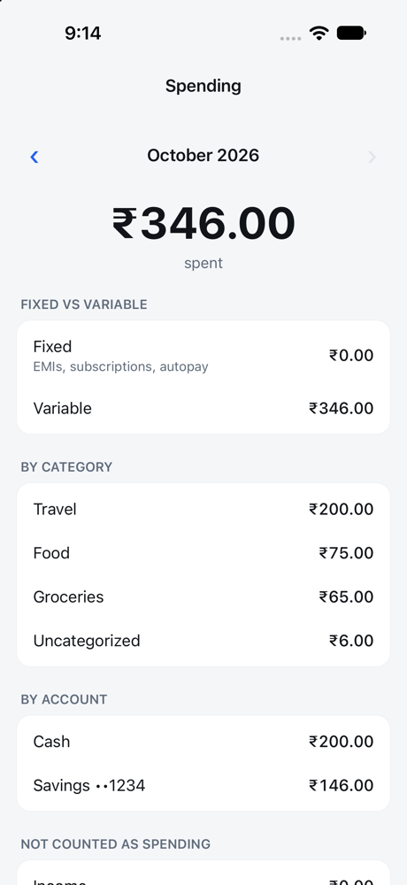
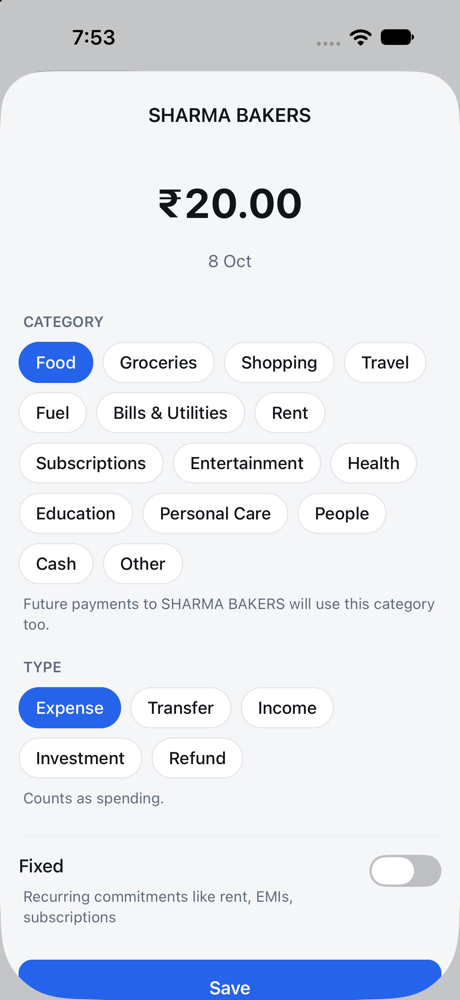
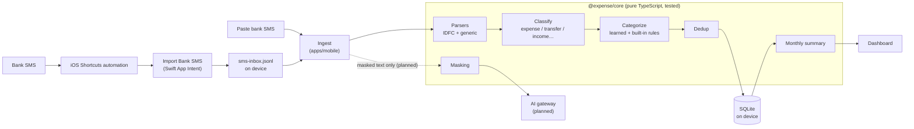

# Expense Tracker

[](https://github.com/ujjwal04/expense-tracker/actions/workflows/ci.yml)

A personal expense tracker for India that answers one question exactly: **how much did I spend this month?**

It reads bank SMS automatically on iPhone, works out which money actually left you (and which only moved between your own accounts), and keeps everything on the phone.

<p>
  
  &nbsp;&nbsp;
  
</p>

## Features

- **Automatic import from bank SMS on iPhone.** iOS doesn't let apps read SMS, so a one-time Shortcuts automation hands each bank message to the app's own **Import Bank SMS** action, which runs silently in the background. [Setup guide](docs/shortcuts-setup.md)
- **No double counting.** Credit card bill payments, transfers between your own accounts, wallet top-ups and investments (SIPs) are recognized and kept out of spending. Refunds reduce it.
- **Self-transfer detection.** Money sent to or received from your own name is a transfer, even with bank spelling differences.
- **Categories that learn.** Built-in rules for common Indian merchants; correcting a category creates a rule, so the next payment there is categorized automatically.
- **Fixed vs variable spend.** Autopay, EMIs and subscriptions are shown separately.
- **Cash.** Log cash expenses; a setting decides whether cash entries or ATM withdrawals count, so cash is never counted twice.
- **Deduplication.** The same payment arriving from SMS and a statement is stored once; two real payments of the same amount are both kept.
- **Private by design.** Transactions live in SQLite on the device. Anything sent to the AI gateway (planned) is masked first: no account numbers, balances or names.

## How it works



The rules that matter most live in `packages/core`, so the app, the planned gateway and the tests all share one implementation:

| Money movement | Counted as |
| --- | --- |
| Card swipe, UPI payment, debit to a merchant | **Expense** |
| Credit card bill paid from savings | Transfer (the swipes were already counted) |
| Transfer to/from your own account | Transfer |
| SIP / mutual fund | Investment |
| Refund or reversal | Refund (reduces spending) |
| Salary and other money received | Income |

**Monthly spend** = expenses (including cash) − refunds. Money is stored as integer **paise**, never floats.

## Tech stack

- **Monorepo:** TypeScript everywhere, npm workspaces
- **`apps/mobile`:** Expo (React Native) with Expo Router, `expo-sqlite`, a small Swift App Intent added through a config plugin
- **`packages/core`:** parsers, classification, categorization, dedup, summary and masking; validated with **zod**, tested with **Vitest**
- **CI:** GitHub Actions runs typecheck, ESLint and tests on every push

## Project structure

```
apps/mobile/
  src/app/                  Screens (Expo Router)
  src/db/                   SQLite schema, migrations and queries
  src/ingest/               SMS import (inbox, deep link, paste)
  plugins/import-sms-intent Swift App Intent + config plugin
packages/core/
  src/parsers/              Bank SMS parsers (IDFC FIRST, generic)
  src/classify.ts           Expense vs transfer vs income...
  src/categorize.ts         Rule-based categories
  src/dedup.ts              Cross-source duplicate detection
  src/summary.ts            Monthly totals
  src/masking.ts            Privacy guard for anything leaving the device
  test/                     Vitest tests with SMS fixtures
docs/                       Shortcuts setup guide, images
```

## Getting started

Requires Node 20+.

```sh
npm install
npm test            # core tests
npm run typecheck
npm run lint
```

### Run the iPhone app

Requires a Mac with Xcode. A free Apple account is enough (the app must be re-installed every 7 days).

```sh
cd apps/mobile
npx expo run:ios                                       # Simulator
npx expo run:ios --device --configuration Release      # your iPhone, works without the Mac afterwards
```

Then set up the [Shortcuts automation](docs/shortcuts-setup.md) so bank SMS are imported automatically.

### Adding a bank

Parsers are small and isolated. Add a parser in `packages/core/src/parsers/`, register it before the generic parser, and add **masked** real-message fixtures plus tests in `packages/core/test/`.

## Roadmap

- [x] Bank SMS parsing, classification, dedup, monthly summary
- [x] iPhone app with background SMS import, categories that learn, cash, settings
- [ ] AI gateway (Node + Fastify): parse unknown formats, categorize new merchants, "chat with your money", monthly insights
- [ ] CSV/PDF statement import
- [ ] Gmail statement fetch
